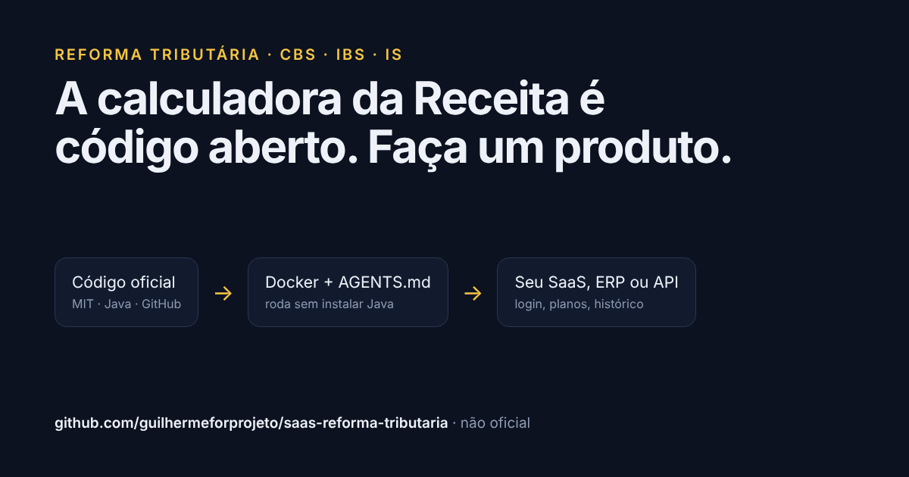

# Build a SaaS on Brazil's Tax Reform Calculator

**Brazil's Federal Revenue Service (Receita Federal) open-sourced its CBS, IBS and Selective Tax calculator on GitHub under the MIT license. This repository teaches your AI to run it and build a product on top of it.**

[🇧🇷 Português](README.md) | 🇺🇸 English



Official code: [ReceitaFederal/calculadora-rtc-regime-regular](https://github.com/ReceitaFederal/calculadora-rtc-regime-regular), a Java REST API that computes CBS, IBS and IS, serves the official tables (CST, `cClassTrib`, NCM, NBS, rates) and generates and validates the tax-group XML for Brazilian e-invoices.

This repo adds a Docker setup that runs it without installing Java, ready-to-run examples, an API summary with the gotchas, product ideas with a minimal architecture, and what to check before selling.

## Easiest way

```text
Read https://github.com/guilhermeforprojeto/saas-reforma-tributaria and follow AGENTS.md. Reply in English.
```

## Run it

```bash
git clone https://github.com/guilhermeforprojeto/saas-reforma-tributaria.git
cd saas-reforma-tributaria
docker compose -f docker/docker-compose.yml up -d --build
bash exemplos/calcular.sh
```

Swagger: `http://localhost:8080/api/swagger-ui.html`.

## Disclaimer

Unofficial; not affiliated with Receita Federal or Serpro. Results support tax calculation and do not replace an accountant. Docs are in Portuguese (the target audience is Brazilian), and AI agents follow them in any language.

Calculator code: Receita Federal do Brasil, MIT. Idea: [@oreidosites](https://www.tiktok.com/@oreidosites). This repo's texts and scripts: [CC BY 4.0](LICENSE).
