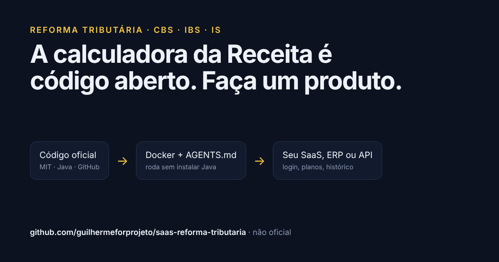

# SaaS em cima da Calculadora da Reforma Tributária

**A Receita Federal abriu no GitHub o código da calculadora de CBS, IBS e Imposto Seletivo, com licença MIT. Este repositório ensina a sua IA a rodar essa calculadora e a construir um produto em cima dela.**

🇧🇷 Português | [🇺🇸 English](README.en.md)



O código oficial está em [ReceitaFederal/calculadora-rtc-regime-regular](https://github.com/ReceitaFederal/calculadora-rtc-regime-regular): uma API em Java que calcula CBS, IBS e IS, consulta as tabelas oficiais (CST, `cClassTrib`, NCM, NBS, alíquotas) e gera e valida o XML dos grupos de tributação das notas. Como a licença é MIT, dá para usar em produto comercial.

Aqui você encontra o que falta para sair do repositório e chegar num produto: um Docker que roda a calculadora sem instalar Java, exemplos prontos, o resumo da API com as pegadinhas, ideias de produto com arquitetura e o que cuidar antes de vender.

---

## Jeito mais fácil: mande o link para a IA

Abra o Claude Code (ou Cursor, Codex) e cole:

```text
Leia https://github.com/guilhermeforprojeto/saas-reforma-tributaria e siga o AGENTS.md.
```

A IA pergunta se você quer só rodar, integrar num sistema seu ou criar um produto, e segue o caminho certo. Outros prompts em [`prompts/pt-BR.md`](prompts/pt-BR.md).

## Rodar em 3 comandos (Docker)

```bash
git clone https://github.com/guilhermeforprojeto/saas-reforma-tributaria.git
cd saas-reforma-tributaria
docker compose -f docker/docker-compose.yml up -d --build
```

Depois:

```bash
bash exemplos/calcular.sh        # ou: python exemplos/calcular.py
```

Swagger: `http://localhost:8080/api/swagger-ui.html`. Sem Docker, com Java 25: veja o caminho B no [`AGENTS.md`](AGENTS.md).

## O que tem aqui

| Arquivo | Para quê |
| --- | --- |
| [`AGENTS.md`](AGENTS.md) | O que a IA faz ao receber o link, e as regras para construir em cima da calculadora |
| [`docker/`](docker) | Dockerfile e compose que compilam o código oficial e sobem a API só no localhost |
| [`docs/API.md`](docs/API.md) | Endpoints, fluxo de uma nota (calcular → gerar XML → validar → injetar), entrada, saída e pegadinhas |
| [`docs/PRODUTO.md`](docs/PRODUTO.md) | 5 ideias de produto, arquitetura mínima e o que cuidar antes de vender |
| [`exemplos/`](exemplos) | A operação de exemplo oficial (4 itens, um com erro de propósito) e clientes em Bash e Python |
| [`prompts/`](prompts) | Prompts prontos em português e inglês |

## Pegadinhas que já estão no AGENTS.md

- A partir de 2027, as alíquotas precisam ir na entrada (`aliquotasNominais`); antes disso, não podem ir.
- No cálculo item a item, a resposta é 200 mesmo com erro: confira o `estadoItem` de cada item.
- A calculadora não tem login: nunca exponha a porta dela na internet.
- Fixe a versão e guarde, em cada cálculo, qual versão foi usada.

## Aviso

Este repositório não é oficial e não tem relação com a Receita Federal ou o Serpro. O resultado da calculadora é apoio ao cálculo e não substitui a análise de um contador. O Dockerfile segue os passos do README oficial (Java 25, Flyway, perfil `offline`); se o build falhar numa versão nova, confira o README oficial.

## Créditos

- Código da calculadora: Receita Federal do Brasil, [licença MIT](https://github.com/ReceitaFederal/calculadora-rtc-regime-regular/blob/main/LICENSE). A operação de exemplo vem do [`docs/exemplos.md`](https://github.com/ReceitaFederal/calculadora-rtc-regime-regular/blob/main/docs/exemplos.md) oficial.
- Ideia: vídeo de [@oreidosites](https://www.tiktok.com/@oreidosites) no TikTok.

## Licença

Os textos e scripts deste repositório: [CC BY 4.0](LICENSE). O código da Receita segue a licença MIT dele.

Se te ajudou, deixa uma ⭐.
